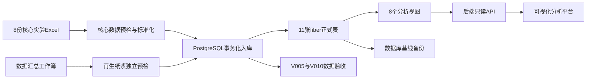
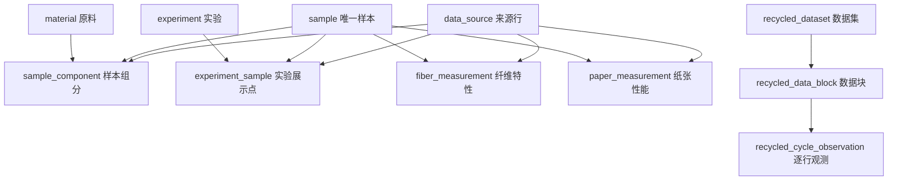

# 植物纤维数据库系统实施过程汇报

> 项目目录：`D:\develop\srp2.0`  
> 数据库：PostgreSQL 18.x  
> 数据库名称：`plant_fiber_db`  
> 业务 Schema：`fiber`  
> 文档日期：2026-09-02

---

## 一、项目目标与当前成果

本项目的数据库部分要解决的核心问题，是把分散在多份 Excel 中的针叶木浆、阔叶木浆、针阔复配实验数据和再生纸浆循环实验数据，整理为结构清晰、可追溯、可校验、可安全查询的数据库，并为后续可视化分析平台提供稳定的数据访问层。

目前已经完成：

1. 明确正式数据范围和排除范围；
2. 完成数据结构分析、单位状态确认和样本统一编码；
3. 选择并建立 PostgreSQL 数据库环境；
4. 设计并创建8张核心表和3张再生纸浆扩展表，共11张正式表；
5. 建立跨表约束、角色权限和基础字典；
6. 实现8份核心实验 Excel 和1份再生纸浆汇总工作簿的只读预检、标准化转换和事务化入库；
7. 完成正式数据验收，并生成数据库基线备份；
8. 建立5个核心分析视图和3个再生纸浆分析视图，共8个视图；
9. 为后续后端 API 和可视化平台开发准备好稳定的数据接口层。

最终正式数据规模如下：

| 数据对象 | 最终数量 | 说明 |
|---|---:|---|
| 基础原料 | 2 | 针叶木浆 SW、阔叶木浆 HW |
| 实验定义 | 3 | 针叶木打浆、阔叶木打浆、针阔复配 |
| 唯一物理样本 | 61 | 28个针叶木、24个阔叶木、9个中间复配样本 |
| 实验展示点 | 63 | 28 + 24 + 11；复配包含两个复用端点 |
| 样本组分 | 70 | 52个纯浆单组分 + 9个复配样本双组分 |
| 纤维特性记录 | 61 | 每个唯一物理样本一条，保留全部12项指标 |
| 纸张性能记录 | 61 | 每个唯一物理样本一条，保留全部9项指标 |
| 数据来源行 | 178 | 能追溯到文件、工作表和Excel原始行 |
| 再生纸浆数据集 | 1 | 对应 `数据汇总(1).xlsx` 正式汇总版 |
| 再生纸浆数据块 | 14 | 使用G01-G14稳定编号，正式处理条件仍为unknown |
| 再生纸浆逐行观测 | 131 | 保留10档长度分布、12项纤维特性和3项纸张原始强度 |
| 数据块×循环汇总点 | 47 | 供循环趋势分析使用 |
| 质量复核记录 | 4 | 长度分布合计偏离100%超过1个百分点 |
| 分析视图 | 8 | 5个核心视图 + 3个再生纸浆扩展视图 |

---

## 二、系统总体架构

系统采用“原始文件—预检转换—正式数据库—分析视图—后端接口—可视化页面”的分层结构。



这里有两个重要原则：

- Excel 是原始来源，不直接承担平台查询任务；
- 可视化前端不直接连接 PostgreSQL，而是通过后端 API 获取数据，后端业务查询统一使用分析视图。

---

## 三、第一阶段：理解项目任务并盘点原始数据

### 3.1 目的

在设计数据库前，必须先弄清楚实验对象、文件关系、样本粒度和数据质量。如果直接根据表头建表，很容易出现重复样本、复配端点重复入库、单位误判和不同文件无法关联等问题。

### 3.2 完成的工作

首先理解了项目说明与分工，确认当前负责内容是：

- 数据库系统；
- 数据入库和质量控制；
- 面向可视化分析平台的数据支持。

随后对 `data/` 文件夹进行了只读盘点，没有改动原始 Excel，也没有建立隔离区。项目先确定8份核心实验来源，后续又确认 `数据汇总(1).xlsx` 作为独立的再生纸浆扩展来源，当前共9份正式来源：

| 序号 | 正式来源文件 | 内容 | 数据行数 | 版本 |
|---:|---|---|---:|---|
| 1 | `针叶木-打浆转数-打浆度(1).xlsx` | 针叶木打浆条件 | 28 | 原始版 |
| 2 | `针叶木-打浆转数-纤维特性(1).xlsx` | 针叶木12项纤维特性 | 28 | 原始版 |
| 3 | `针叶木-打浆转数-纸张性能(1).xlsx` | 针叶木9项纸张性能 | 28 | 原始版 |
| 4 | `data1-阔叶木-打浆转数-打浆度(1).xlsx` | 阔叶木打浆条件 | 24 | 原始版 |
| 5 | `data2-阔叶木-打浆转数-纤维特性(1).xlsx` | 阔叶木12项纤维特性 | 24 | 原始版 |
| 6 | `data3-阔叶木-打浆转数-纸张性能(1).xlsx` | 阔叶木9项纸张性能 | 24 | 原始版 |
| 7 | `data4-针阔-复配-纤维特性0110(1).xlsx` | 复配12项纤维特性 | 11 | 0110 |
| 8 | `data5-针阔-复配-纸张特性0110(1).xlsx` | 复配9项纸张性能 | 11 | 0110 |
| 9 | `数据汇总(1).xlsx` | 再生纸浆循环实验逐行数据 | 131 | 正式汇总版 |

明确排除：

- `data4-针阔-复配-纤维特性(1).xlsx`：复配旧版；
- `data5-针阔-复配-纸张特性(1).xlsx`：复配旧版。

### 3.3 关键业务确认

复配实验使用：

- 针叶木浆：14000 r，41.0°SR；
- 阔叶木浆：8000 r，40.6°SR。

复配编号从 `zk010` 到 `zk100`：

- `zk010` 表示0%针叶木、100%阔叶木，复用纯浆样本 `HW_R08000`；
- `zk100` 表示100%针叶木、0%阔叶木，复用纯浆样本 `SW_R14000`；
- 中间9点才创建新的复配样本。

这个设计避免了把同一个物理样本复制成两条数据库记录，也是“61个唯一样本、63个实验展示点”数量不同的原因。

### 3.4 单位和聚合规则

- 12项纤维特性全部保留，不在入库阶段提前筛选变量；
- 9项纸张性能全部保留；
- 纸张性能保存剔除偏差值后的最终均值，`replicate_count=3`；
- 透气度源表未标单位，数值原样保存，设计暂按 `μm/(Pa·s)` 标记；
- 耐折度单位不确定，字段命名为 `folding_endurance_raw`，不推断、不换算。

---

## 四、第二阶段：选择数据库系统并建立环境

### 4.1 为什么选择PostgreSQL

经过对 Oracle、MySQL、SQLite、SQL Server 和 PostgreSQL 的比较，最终选择 PostgreSQL，主要原因是：

- 免费开源，适合科研项目和后续部署；
- 事务、外键、检查约束、触发器和视图能力完善；
- 能准确表达复配比例、样本唯一性和跨行合计等业务规则；
- 支持多用户、角色权限和网络部署，比 SQLite 更适合正式平台；
- 不依赖 Oracle 或 SQL Server 的商业授权和特定生态；
- 与 Python 后端、REST API 和可视化系统衔接方便。

SQLite适合单机小工具，但不适合作为多人在线平台的中心数据库；Oracle和SQL Server能力强，但当前数据规模不需要其较高的部署和管理成本；MySQL可以完成基础存储，但本项目更重视复杂约束、严谨事务和分析视图，因此PostgreSQL更合适。

### 4.2 环境配置

最终环境：

| 项目 | 配置 |
|---|---|
| PostgreSQL版本 | 18.x |
| 数据库 | `plant_fiber_db` |
| 编码 | UTF-8 |
| 时区 | `Asia/Shanghai` |
| 业务Schema | `fiber` |

角色设计：

| 角色 | 是否登录 | 作用 |
|---|---|---|
| `postgres` | 是 | 数据库管理员，执行环境配置和版本迁移 |
| `fiber_owner` | 否 | 拥有 `fiber` Schema、表、触发器和视图 |
| `fiber_importer` | 是 | 正式数据导入；可写业务表但不能删除数据 |
| `fiber_reader` | 是 | 后端开发和查询验证；只能读取，不能写入 |

环境建设过程中还完成了：

- 使用干净模板创建数据库；
- 建立 `fiber` Schema，避免业务对象全部堆放在默认 `public` 中；
- 收回 `PUBLIC` 的宽泛权限；
- 为不同角色设置 `search_path`；
- 配置当前对象和未来对象的默认权限；
- 验证 `fiber_importer`、`fiber_reader` 可以登录且权限边界正确。

这一阶段的环境命令是在 PostgreSQL 中交互执行的，目前没有单独的 `V000` 文件；V001以后所有数据库结构变化均采用版本化 SQL 文件管理。

---

## 五、第三阶段：设计数据模型和正式数据字典

### 5.1 为什么设计成11张表

数据库没有把所有指标放在一张“数据大表”中，而是按数据粒度分层建模。8张核心表分别保存原料、实验、唯一物理样本、实验展示点、样本组分、纤维测量、纸张测量和来源信息；后来导入的再生纸浆循环数据具有“数据集—数据块—逐行观测”的不同粒度，因此新增3张独立扩展表，而不是强行混入最终均值样本表。这样可以避免重复和语义混淆，并保留完整追溯链。



### 5.2 11张表及作用

| 表名 | 数据粒度 | 主键 | 作用 | 最终行数 |
|---|---|---|---|---:|
| `material` | 每行一种基础原料 | `material_id` | 保存SW和HW两类原料 | 2 |
| `experiment` | 每行一个实验 | `experiment_id` | 定义两类打浆实验和一类复配实验 | 3 |
| `sample` | 每行一个唯一物理样本 | `sample_id` | 统一样本身份，复配端点复用纯浆样本 | 61 |
| `data_source` | 每行一个正式Excel来源行 | `source_id` | 保存文件、Sheet、行号、版本和导入时间 | 178 |
| `experiment_sample` | 每行一个实验展示点 | `experiment_id + sample_id` | 保存实验内编号和显示顺序 | 63 |
| `sample_component` | 每行一个样本原料组分 | `sample_id + material_id` | 保存比例、打浆转数和打浆度 | 70 |
| `fiber_measurement` | 每个样本一条测量记录 | `sample_id` | 保存全部12项纤维特性 | 61 |
| `paper_measurement` | 每个样本一条最终均值 | `sample_id` | 保存全部9项纸张性能及聚合信息 | 61 |
| `recycled_dataset` | 每行一个来源数据集 | `dataset_id` | 保存汇总工作簿、版本、SHA-256和导入元数据 | 1 |
| `recycled_data_block` | 每行一个连续数据块 | `block_id` | 保存G01-G14、原料判定依据和未知条件状态 | 14 |
| `recycled_cycle_observation` | 每行一次原始观测 | `observation_id` | 保存循环、重复、源行和25项原始指标 | 131 |

### 5.3 样本编码

稳定编码不依赖数据库自增ID，便于跨文件和平台接口使用：

- 针叶木：`SW_R{5位打浆转数}`，例如 `SW_R14000`；
- 阔叶木：`HW_R{5位打浆转数}`，例如 `HW_R08000`；
- 中间复配：`BLEND_SW{3位比例}_HW{3位比例}`，例如 `BLEND_SW050_HW050`。

### 5.4 设计文档和数据字典文件

| 文件 | 功能与作用 |
|---|---|
| `output/docs/植物纤维数据库设计说明.docx` | 早期数据库方案文档，记录最初的数据模型思路，保留作设计历史参考 |
| `output/docs/植物纤维数据库设计说明_当前版.docx` | 当前通用设计说明；保持“8张核心表”口径，并补充3张再生纸浆扩展表和8个分析视图 |
| `output/docs/植物纤维数据库设计说明_PostgreSQL实施版.docx` | 最终实施版设计说明；明确PostgreSQL、11张表、角色、约束、入库和实施路线，是数据库设计的主要文字依据 |
| `outputs/019facac-6737-7d71-b0da-bff0a034bc69/植物纤维数据库_数据字典与入库映射.xlsx` | 核心数据库阶段的数据字典历史版本 |
| `outputs/019facac-6737-7d71-b0da-bff0a034bc69/植物纤维数据库_数据字典与入库映射_当前版.xlsx` | 当前正式数据字典与Excel入库映射，是字段名称、类型、单位、来源、转换和校验规则的权威清单 |

数据字典工作簿包含4个工作表：

1. `01_数据表目录`：11张表、9份正式来源工作簿及2份排除文件；
2. `02_字段数据字典`：114个字段的类型、单位、约束和说明；
3. `03_入库映射`：229条Excel列到数据库字段的直接、派生、关联和排除规则；
4. `04_规则与验收`：30条正式入库与交付验收规则。

---

## 六、第四阶段：按依赖顺序建立数据库结构

数据库结构采用版本化迁移文件管理。每个文件只负责一个明确阶段，发生错误时由事务回滚，避免数据库停留在“只建了一半”的状态。

### 6.1 V001：创建核心表

文件：`database/migrations/V001__create_core_tables.sql`

功能：

- 按依赖顺序创建8张表、56个字段；
- 创建8个主键、10个外键、唯一约束和数值范围约束；
- 建立高频查询索引；
- 给表和关键字段添加数据库注释；
- 把8份核心实验来源写入核心 `data_source` 白名单约束，从数据库层拒绝旧复配版；后续的汇总工作簿由V008扩展表和独立导入流程管理；
- 设置 `fiber_importer` 和 `fiber_reader` 的基础权限。

它是一次性迁移，没有使用 `CREATE TABLE IF NOT EXISTS`，目的是在重复执行或现有结构不一致时立即报错，而不是掩盖问题。

### 6.2 V002：建立跨行组分约束

文件：`database/migrations/V002__component_ratio_trigger.sql`

普通 `CHECK` 只能检查当前一行，无法判断一个复配样本的两条组分是否合计100%。因此V002建立了延迟约束触发器，在事务提交前检查最终状态：

- 针叶木纯浆只能有一个100%的SW组分；
- 阔叶木纯浆只能有一个100%的HW组分；
- 复配样本必须有SW和HW两个组分；
- 两个比例都必须大于0、小于100并合计100%；
- SW必须为14000 r、41.0°SR；
- HW必须为8000 r、40.6°SR；
- 新建样本后如果没有组分，提交时也会失败。

### 6.3 V003：写入固定基础字典

文件：`database/migrations/V003__seed_reference_data.sql`

功能：

- 写入 `SW`、`HW` 两种基础原料；
- 写入 `SW_BEATING`、`HW_BEATING`、`BLEND` 三类实验；
- 使用幂等更新方式，重复执行不会生成重复记录；
- 执行后检查必须恰好为2种原料、3类实验。

### 6.4 V004：验收空库结构与权限

文件：`database/migrations/V004__verify_schema.sql`

这是只读验收脚本，检查：

- 数据库名称、UTF-8编码和上海时区；
- 8张表和56个字段；
- 表所有者、主键、外键和触发器数量；
- 2种原料和3类实验；
- 导入账号和只读账号的登录属性；
- 数据库、Schema、表和序列权限。

实际执行结果为 `PASS`，证明数据库环境和空库结构符合设计。

---

## 七、第五阶段：实现只读预检和事务化正式入库

### 7.1 为什么不能直接把Excel复制进数据库

8份核心实验 Excel 的表头、行数和关联键并不完全相同，复配端点还必须复用已有纯浆样本。如果直接手工插入，很容易出现：

- 漏列或错列；
- 把空白错误地变成0；
- 旧复配版进入正式库；
- 同一个样本重复创建；
- 复配比例和固定打浆条件错误；
- 只导入一部分后中途失败；
- 无法追溯到原始文件行。

因此采用“两阶段”流程：先只读预检和标准化，全部通过后再在一个数据库事务中写入。


### 7.2 入库程序文件及作用

| 文件 | 功能与作用 |
|---|---|
| `database/importer/etl_core.py` | 核心实验入库模块；保存8份核心文件白名单、准确表头、字段映射、数值范围、样本编码、端点复用、数量校验和SQL生成逻辑 |
| `database/importer/precheck_data.py` | 只读预检入口；不连接数据库，只读取Excel并生成预检报告 |
| `database/importer/import_data.py` | 正式入库入口；重新预检、生成SQL，并且只有带 `--apply` 时才调用PostgreSQL执行写入和V005验收 |
| `database/importer/requirements.txt` | 声明Excel读取依赖 `openpyxl>=3.1,<4` |
| `database/importer/run_precheck.ps1` | PowerShell简化入口，调用只读预检程序 |
| `database/importer/run_import.ps1` | PowerShell简化入口，调用正式入库程序并进入确认流程 |
| `database/importer/README.md` | 说明文件范围、固定规则、预检命令、正式入库命令、安全机制和失败处理方式 |

`__pycache__/` 下的 `.pyc` 文件是Python运行时自动生成的缓存，不属于正式交付成果，也不承担业务功能。

### 7.3 预检和生成结果

| 文件 | 功能与作用 |
|---|---|
| `database/importer/reports/precheck_report.json` | 机器可读预检结果，记录状态、数量、告警和8个文件的SHA-256 |
| `database/importer/reports/precheck_report.md` | 人工可读预检报告，便于审查和汇报 |
| `database/importer/reports/formal_import_generated.sql` | 预检通过后生成的正式数据SQL；包含178条来源、61个样本及其他业务记录，并在事务中执行 |

实际预检结果：

- 状态：`PASS`；
- 阻断错误：0；
- 告警：2，分别是透气度单位暂定和耐折度单位待确认；
- 6类核心记录数量全部符合设计。

正式入库使用 `fiber_importer`，程序还设置了以下保护：

- 必须连接 `plant_fiber_db`；
- 必须使用 `fiber_importer`；
- 6张业务表必须为空；
- 任一写入、外键、约束或核心数量检查失败时，整个事务回滚；
- 已经成功入库后再次执行，会因业务表非空而被拒绝，不会覆盖已有数据。

### 7.4 V005：正式数据验收

文件：`database/migrations/V005__verify_imported_data.sql`

它以只读事务检查：

- 61、63、70、61、61、178六类核心数量；
- 针叶木28个、阔叶木24个、中间复配9个；
- 复配11个展示点的编号、顺序和端点复用；
- 组分数、比例合计和固定打浆条件；
- 每个样本均有纤维和纸张测量；
- 当前正式数据没有意外NULL；
- 8份核心实验来源的文件名、版本和行数；
- 展示点、组分、纤维和纸张数据引用了正确的权威来源文件。

正式环境执行结果为 `PASS`。

---

## 八、第六阶段：建立数据基线备份

### 8.1 目的

正式数据入库并通过V005后，先保存一个可恢复的正确状态，再继续建立分析视图和开发平台。这样即使后续误操作或开发失败，也能恢复到“正式数据刚验收完成”的状态。

### 8.2 备份脚本和说明文件

| 文件 | 功能与作用 |
|---|---|
| `database/backup/create_baseline_backup.ps1` | 调用 `pg_dump` 生成自定义格式备份，随后用 `pg_restore --list` 检查归档可读性，并生成SHA-256记录 |
| `database/ANALYSIS_VIEWS_AND_BACKUP.md` | 说明备份、V006/V007执行顺序、5个视图作用、预期验收结果和只读查询示例 |

### 8.3 实际备份文件

| 文件 | 功能与作用 |
|---|---|
| `backups/plant_fiber_db_baseline_20260901_171451.dump` | PostgreSQL自定义格式最新基线归档，大小100,374字节，包含11张表和8个视图 |
| `backups/plant_fiber_db_baseline_20260901_171451.dump.restore-list.txt` | 归档内部对象目录，共166行，证明 `pg_restore` 可以读取备份结构 |
| `backups/plant_fiber_db_baseline_20260901_171451.dump.sha256.txt` | 保存备份文件名、数据库、时间和SHA-256，用于检查文件完整性 |

SHA-256：

```text
5f54f8d0ce8030db239bc7a35933b5f7846cf8609e0fc5553172b5cfe88f9f35
```

已重新计算实际文件指纹，与记录完全一致。

这份最新备份在V001至V010全部执行成功、核心数据和再生纸浆循环数据均通过验收后生成，已经包含11张正式表、8个分析视图以及正式数据。较早的2026-08-03和2026-08-13备份继续保留作阶段性历史基线。

目前完成的是备份可读性和哈希完整性检查；最终项目交付前还应在空环境完成一次完整恢复演练。

---

## 九、第七至第九阶段：建立8个分析视图并完成扩展数据验收

### 9.1 为什么还需要视图

11张正式表是规范化存储结构，适合保证数据一致性，但可视化页面如果每次都自己连接多张表，会导致SQL复杂、口径不一致，并让前端过度依赖底层表结构。

分析视图提供稳定的只读查询层：底层是11张正式表，视图不复制数据；每次查询视图时，PostgreSQL实时组合最新数据。

### 9.2 V006：创建分析视图

文件：`database/migrations/V006__create_analysis_views.sql`

V006在确认61个样本和178条来源存在后，一次性创建5个视图：

| 视图 | 粒度 | 行数 | 主要用途 |
|---|---|---:|---|
| `fiber.v_sample_overview` | 每个唯一样本一行 | 61 | 样本身份、SW/HW比例及两种原料打浆条件 |
| `fiber.v_fiber_paper_analysis` | 每个唯一样本一行 | 61 | 将12项纤维特性和9项纸张性能组成分析宽表 |
| `fiber.v_beating_analysis` | 每个纯浆实验展示点一行 | 52 | 绘制针叶木和阔叶木打浆变化曲线 |
| `fiber.v_blend_analysis` | 每个复配展示点一行 | 11 | 绘制复配比例与各项性能的关系 |
| `fiber.v_data_lineage` | 每个来源用途一行 | 257 | 追溯到Excel文件、Sheet1和原始行号，覆盖178条来源 |

V006是一次性迁移；如果发现视图已存在，会主动报错，防止无意覆盖已经部署的视图定义。

### 9.3 V007：设置权限并验收视图

文件：`database/migrations/V007__grant_and_verify_analysis_views.sql`

功能：

- 收回5个视图的公共权限和写入权限；
- 向 `fiber_importer`、`fiber_reader` 授予视图查询权；
- 验证5个视图名称、字段数、所有者和权限；
- 验证61、61、52、11、257等视图行数；
- 验证来源视图覆盖全部178条来源；
- 验证 `zk010` 和 `zk100` 的端点映射及比例；
- 验证 `fiber_reader` 仍然只能读、不能写。

实际执行结果：

| 验收项 | 结果 |
|---|---:|
| `verification_status` | PASS |
| 分析视图数 | 5 |
| 样品概览行数 | 61 |
| 分析宽表行数 | 61 |
| 打浆视图行数 | 52 |
| 复配视图行数 | 11 |
| 追溯视图行数 | 257 |
| 覆盖来源行数 | 178 |

V007可以重复执行，用来恢复或复核视图权限。V006成功后不要重复执行。

当前为了兼容既有权限基线，`fiber_reader`保留对11张正式表的只读权限，但没有任何写入权限。平台代码应统一查询8个视图。若上线时希望从数据库权限层严格限制“只能查视图”，可以新增权限更小的 `fiber_app` 角色供后端使用。

### 9.4 V008至V010：再生纸浆扩展表、视图与验收

`数据汇总(1).xlsx`与原61个最终均值样本的数据粒度不同，因此采用独立扩展模型：

| 迁移文件 | 功能 | 验收结果 |
|---|---|---|
| `V008__create_recycled_pulp_tables.sql` | 创建 `recycled_dataset`、`recycled_data_block`、`recycled_cycle_observation` 3张扩展表及约束、索引和权限 | 成功 |
| `V009__create_recycled_pulp_views.sql` | 创建明细、循环汇总和质量复核3个扩展视图 | 成功 |
| `V010__verify_recycled_pulp_import.sql` | 验证数据集、数据块、观测、汇总点、质量复核行和权限 | PASS |

三个扩展视图为：

| 视图 | 行数 | 主要用途 |
|---|---:|---|
| `fiber.v_recycled_cycle_detail` | 131 | 查询逐行原始观测及来源行 |
| `fiber.v_recycled_cycle_summary` | 47 | 查询数据块×循环的平均值，用于趋势图 |
| `fiber.v_recycled_data_quality` | 4 | 定位长度分布合计偏离100%超过1个百分点的记录 |

工作簿没有给出14个数据块的正式处理条件，因此数据库保留G01-G14稳定编号，将 `metadata_status` 记录为 `unknown`、`condition_label` 保持 `NULL`，不根据数值推测实验名称。三项纸张指标保存为抗张强度、耐破强度和撕裂强度，不与核心表中的三个指数混用。

---

## 十、完整文件清单与职责边界

以下是当前数据库系统正式成果。源Excel、项目PDF和PPT属于输入资料，不属于本阶段生成文件。

### 10.1 设计与数据规范

| 路径 | 职责 |
|---|---|
| `output/docs/植物纤维数据库设计说明.docx` | 初始设计历史文档 |
| `output/docs/植物纤维数据库设计说明_当前版.docx` | 当前通用设计说明：8张核心表、3张扩展表和8个视图 |
| `output/docs/植物纤维数据库设计说明_PostgreSQL实施版.docx` | PostgreSQL最终实施设计说明 |
| `outputs/019facac-6737-7d71-b0da-bff0a034bc69/植物纤维数据库_数据字典与入库映射_当前版.xlsx` | 11张表、114字段、229映射、30规则的正式数据规范 |

### 10.2 数据库版本迁移

| 路径 | 职责 | 是否可重复执行 |
|---|---|---|
| `database/migrations/V001__create_core_tables.sql` | 建立8张表、约束、索引和基础权限 | 否 |
| `database/migrations/V002__component_ratio_trigger.sql` | 建立纯浆和复配跨行组分约束 | 否 |
| `database/migrations/V003__seed_reference_data.sql` | 写入2种原料和3类实验 | 是，幂等 |
| `database/migrations/V004__verify_schema.sql` | 验收空库结构、约束、角色和权限 | 是，只读 |
| `database/migrations/V005__verify_imported_data.sql` | 验收正式数据内容和数量 | 是，只读 |
| `database/migrations/V006__create_analysis_views.sql` | 创建5个分析视图 | 否 |
| `database/migrations/V007__grant_and_verify_analysis_views.sql` | 设置视图权限并验收 | 是 |
| `database/migrations/V008__create_recycled_pulp_tables.sql` | 创建3张再生纸浆扩展表及其约束、索引和权限 | 否 |
| `database/migrations/V009__create_recycled_pulp_views.sql` | 创建3个再生纸浆分析视图 | 否 |
| `database/migrations/V010__verify_recycled_pulp_import.sql` | 验收扩展数据、视图和权限 | 是，只读 |

### 10.3 数据预检与入库

| 路径 | 职责 |
|---|---|
| `database/importer/etl_core.py` | 核心映射、校验、标准化和SQL生成 |
| `database/importer/precheck_data.py` | 只读预检命令入口 |
| `database/importer/import_data.py` | 正式入库命令入口 |
| `database/importer/requirements.txt` | Python依赖声明 |
| `database/importer/run_precheck.ps1` | 一键运行预检 |
| `database/importer/run_import.ps1` | 一键运行正式入库 |
| `database/importer/README.md` | 入库操作和安全说明 |
| `database/importer/reports/precheck_report.json` | 机器可读预检证据 |
| `database/importer/reports/precheck_report.md` | 人工可读预检证据 |
| `database/importer/reports/formal_import_generated.sql` | 本批正式数据的事务化SQL |
| `database/importer/recycled_summary_core.py` | 汇总工作簿结构识别、数值校验、数据块生成、质量标记和SQL生成 |
| `database/importer/precheck_recycled_summary.py` | 再生纸浆汇总数据只读预检入口 |
| `database/importer/import_recycled_summary.py` | 再生纸浆汇总数据正式入库入口 |
| `database/importer/reports/recycled_summary_precheck_report.json` | 再生纸浆预检数量、文件散列、数据块和质量复核证据 |
| `database/importer/reports/recycled_summary_import_generated.sql` | 1个数据集、14个数据块和131条观测的事务化SQL |

### 10.4 备份与分析视图说明

| 路径 | 职责 |
|---|---|
| `database/backup/create_baseline_backup.ps1` | 创建、检查并记录数据库基线备份 |
| `database/ANALYSIS_VIEWS_AND_BACKUP.md` | 备份、视图、权限和查询操作手册 |
| `backups/plant_fiber_db_baseline_20260901_171451.dump` | 包含11张表、8个视图和正式数据的最新可恢复基线 |
| `backups/plant_fiber_db_baseline_20260901_171451.dump.restore-list.txt` | 最新备份归档目录 |
| `backups/plant_fiber_db_baseline_20260901_171451.dump.sha256.txt` | 最新备份完整性记录 |

---

## 十一、系统安全性、完整性和可追溯性

### 11.1 数据完整性

- 主键防止相同实体重复；
- 唯一约束防止样本代码、展示编号和来源位置重复；
- 外键防止测量记录引用不存在的样本或来源；
- `CHECK` 防止负数、非法百分比和错误枚举；
- 延迟约束触发器检查复配跨行比例和固定打浆条件；
- 入库前、事务内和入库后三层校验共同保证数据正确。

### 11.2 权限安全

- 管理员负责迁移；
- `fiber_owner`负责对象所有权但不能登录；
- `fiber_importer`不能删除正式数据，也不能修改基础原料和实验定义；
- `fiber_reader`只读，不能新增、修改或删除数据；
- 视图不向 `PUBLIC` 开放写入权限；
- 数据库密码不写入Python、SQL、报告或前端代码。

### 11.3 来源追溯

每条正式来源包含：

- 文件名；
- 工作表 `Sheet1`；
- Excel实际行号；
- 原始版或0110版本；
- 导入时间。

`v_data_lineage`进一步把来源行关联到实验展示点、样本组分、纤维测量或纸张测量。复配纸张文件的两个端点只用于一致性核对，因此显示为 `source_only`，但仍被正式保存和覆盖。

---

## 十二、正确的执行顺序与故障处理

数据库从空环境建立到当前状态的顺序是：

```text
建立数据库、Schema和角色
    ↓
V001 创建8张表
    ↓
V002 创建跨行约束触发器
    ↓
V003 写入基础字典
    ↓
V004 验收结构和权限
    ↓
Excel只读预检
    ↓
事务化正式入库
    ↓
V005 验收正式数据
    ↓
创建数据基线备份
    ↓
V006 创建5个分析视图
    ↓
V007 设置权限并验收视图
    ↓
V008 创建3张再生纸浆扩展表
    ↓
V009 创建3个再生纸浆分析视图
    ↓
再生纸浆汇总数据只读预检与事务化入库
    ↓
V010 验收扩展数据、视图和权限
    ↓
创建包含11张表和8个视图的最新基线备份
```

故障处理原则：

- 只看第一条 `ERROR`，后续错误通常是连锁结果；
- V001、V002、V006、V008、V009属于一次性迁移，成功后不要重复执行；
- V003、V004、V005、V007、V010可以按其设计重复执行；
- 正式入库程序发现业务表非空会拒绝再次导入；
- 不使用手工逐表删除、`DROP` 或清空数据来“重试”；
- 需要重建时，先确认备份和目标范围，再制定受控恢复方案。

---

## 十三、从本地开发到平台上线

当前 PostgreSQL 部署在本机，适合开发和演示。同一台电脑上的后端可以通过 `localhost:5432` 连接数据库，但其他用户的浏览器不会直接连接数据库。

正式平台架构应为：

```text
用户浏览器 --HTTPS--> 前端/后端服务器 --私有连接--> PostgreSQL
```

上线原则：

- 只向公网开放HTTPS端口，不公开 PostgreSQL 5432；
- 用户只调用后端API，不获得数据库地址和密码；
- 后端使用只读数据库账号查询8个分析视图；
- 数据库密码通过服务器环境变量保存，不进入前端代码或Git；
- 将本地备份恢复到服务器，或在服务器按迁移顺序重建；
- 恢复2026-09-01最新基线备份后，11张表和8个视图均已包含在归档中；
- 上线前完成一次空环境恢复演练。

---

## 十四、下一阶段工作

数据库的核心建设工作已经完成。下一阶段应按以下顺序推进：

1. 制定后端API数据契约；
2. 确定指标中文名、字段名、单位、小数位和前端展示形式；
3. 视安全要求决定是否新增只能查询8个视图的 `fiber_app` 角色；
4. 实现样本概览、打浆分析、复配分析、综合分析、再生纸浆循环分析和来源追溯接口；
5. 对接口排序、筛选、空值和错误响应进行测试；
6. 开发可视化页面；
7. 完成权限测试、备份恢复测试和部署测试；
8. 将数据库、后端和前端部署到服务器，并通过HTTPS提供访问。

当前数据规模由61个最终均值样本和131条再生纸浆逐行观测构成，仍不需要复杂的分布式架构或大数据平台。重点应放在指标口径、图表交互、来源追溯和部署安全上。

---

## 十五、汇报时可使用的简要讲述

本项目首先对原始数据进行了只读盘点，确定8份核心实验Excel，并排除两份旧复配版。后来又将 `数据汇总(1).xlsx` 作为独立的再生纸浆循环数据集正式导入。针对复配实验，明确使用针叶木14000转、41度SR和阔叶木8000转、40.6度SR，同时让两个复配端点复用对应纯浆样本，避免重复数据。

在数据库选型上，综合考虑科研项目成本、事务、约束、多用户访问和后续部署，最终选择PostgreSQL。数据库采用 `plant_fiber_db` 和 `fiber` Schema，并通过所有者、导入和只读角色实现职责分离。

数据模型当前由11张正式表组成：8张核心表分别管理原料、实验、唯一物理样本、实验展示点、样本组分、纤维特性、纸张性能和来源行；3张扩展表管理再生纸浆数据集、14个数据块和131条逐行观测。通过主键、外键、检查约束和延迟触发器，保证数据结构和业务规则正确。

正式入库不是直接复制Excel，而是先进行白名单、表头、行数、数值、样本编码和复配端点校验。预检通过后，程序在一个事务中写入61个样本、63个展示点、70条组分、61条纤维记录、61条纸张记录和178条来源记录，随后由V005进行只读验收。

核心数据通过验收后创建了5个核心分析视图；再生纸浆扩展数据通过V008至V010建立3张表和3个扩展视图。当前共8个分析视图，为打浆曲线、复配分析、纤维与纸张综合分析、来源追溯、循环趋势和质量复核提供统一查询入口，最终验收结果均为PASS。

因此，当前数据库已经具备结构规范、数据完整、来源可追溯、权限受控、可以备份恢复以及支持可视化查询等能力。下一步是在8个分析视图之上建立只读后端API，再开发可视化页面并完成服务器部署。

---

## 十六、结论

整个数据库系统不是简单地把Excel搬进PostgreSQL，而是完成了从数据边界确认、统一编码、规范化建模、字段映射、约束设计、自动预检、事务化入库、正式验收、基线备份到分析视图的完整工程流程。

当前系统已经形成三个稳定层次：

1. **正式数据层**：8张核心表和3张扩展表，负责准确存储和约束；
2. **分析访问层**：5个核心视图和3个扩展视图，负责向后端和可视化提供统一口径；
3. **审计与恢复层**：来源追溯、预检报告、V004/V005/V007/V010验收和数据库备份。

这为后续后端接口、可视化分析和正式部署提供了可靠的数据基础。
